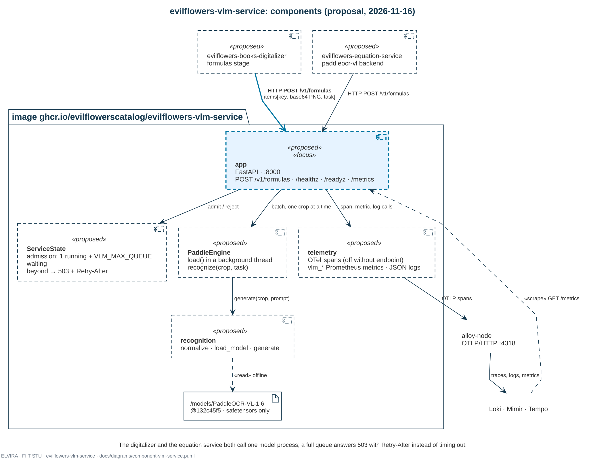

# evilflowers-vlm-service

The shared formula model server of EvilFlowers: [PaddleOCR-VL](https://huggingface.co/PaddlePaddle/PaddleOCR-VL-1.6)
behind one HTTP endpoint, `POST /v1/formulas`. It runs CPU-only, with the weights baked into
the image.

Callers:
- evilflowers-books-digitalizer, the formulas stage (EvilFlowersCatalog/evilflowers-books-digitalizer#1);
- evilflowers-equation-service, the `paddleocr-vl` backend (EvilFlowersCatalog/evilflowers-equation-service#8).

Deployment: Deployment `vlm` in namespace `shared`, `http://vlm.shared.svc.cluster.local`
(EvilFlowersCatalog/knowledge#67, Ansible `roles/inference`).

> **Good at maths, not used for text.** In the digitalizer's lab, PaddleOCR-VL transcribed
> formulas well and Slovak prose badly. The `ocr` task exists for short mixed snippets.
> Running text goes through Tesseract, not this service.



## API

### `POST /v1/formulas`

```json
{"items": [{"key": "p12-r3", "image": "<base64 PNG>", "task": "formula"}]}
```

| Field | Rule |
|---|---|
| `items` | 1 to 32 per request (otherwise `422`) |
| `key` | 1 to 256 characters, echoed back |
| `image` | base64 PNG of the region crop, at most 8 MB decoded |
| `task` | `formula` (default, prompt `Formula Recognition:`) or `ocr` (`OCR:`) |

Response `200`:

```json
{"model": "PaddleOCR-VL-1.6",
 "results": [{"key": "p12-r3", "text": "\\frac{a}{b}", "error": null, "secs": 4.12}]}
```

Each item succeeds or fails on its own. A bad image (not base64, not an image, too large) or a
model error sets `error`, leaves `text` null, and the other items still run. `text` is the raw
model output; cleaning the LaTeX is the caller's job.

Before the server runs a crop, it pads the crop to an aspect ratio of at most 10:1 and a minimum
of 64 px, then scales it down to at most 1,003,520 pixels (`recognition.normalize`). For results
that match the lab's, crop like `recognition.crop` does: the bbox plus 10 px of context.

**Back-pressure.** The model runs one crop at a time per process. A request holds the model for
its whole batch. Up to `VLM_MAX_QUEUE` further requests wait behind it. Beyond that, and while
the model is still loading, the server answers `503` with `Retry-After` (seconds, estimated from
the recent request time). Retry after that delay. Do not shorten the read timeout below a full
batch's time.

### Probes and metrics

| Endpoint | Answers |
|---|---|
| `GET /healthz` | `200` once the process runs; `500` if the model failed to load (restart it) |
| `GET /readyz` | `503` while the weights load (in a background thread); `200` with `load_secs` and `queue` once ready |
| `GET /metrics` | Prometheus text: `vlm_items_total{task,outcome}`, `vlm_item_seconds{task}` (histogram), `vlm_queue_rejections_total{reason}` (`loading` / `busy`) |

## Model

| | |
|---|---|
| Weights | `PaddlePaddle/PaddleOCR-VL-1.6` @ `132c45f52c0a26ed5a6b2f6bd8e3985794cc27dd`, at `/models/PaddleOCR-VL-1.6` in the image |
| Files fetched | `*.safetensors`, `*.json`, `tokenizer.model`, `chat_template.jinja`, `LICENSE`. No pickles and no remote code: the build fails if a `.bin`/`.pt`/`.pth`/`.pkl`/`.py` appears. |
| Runtime | CPU-only `torch==2.12.0` / `torchvision==0.27.0`, `transformers==5.22.2` (as validated), float32, SDPA attention, KV cache on |
| Generation | greedy, at most 512 new tokens, `repetition_penalty=1.05` |
| Offline | `HF_HUB_OFFLINE=1`, `TRANSFORMERS_OFFLINE=1`; the container needs no network |

### Measured CPU latency per crop (app01)

| | Cold (first crop after load) | Warm |
|---|---|---|
| per formula crop | _to be measured on app01 (knowledge#67)_ | _to be measured_ |
| model load | _to be measured_ | — |

## Configuration

| Variable | Default | Meaning |
|---|---|---|
| `VLM_MODEL_DIR` | `/models/PaddleOCR-VL-1.6` (image) | the safetensors directory |
| `VLM_DEVICE` | `cpu` | `cpu`, `cuda`, `mps` or `auto` |
| `VLM_THREADS` | `0` | torch intra-op threads. **Set it equal to the CPU limit.** torch sizes its pool from the host's cores, not the cgroup limit; `0` leaves that default and logs a warning. |
| `VLM_MAX_QUEUE` | `2` | requests that may wait behind the running one before `503` |
| `VLM_PORT`, `VLM_HOST` | `8000`, `0.0.0.0` | listener |
| `VLM_DTYPE` | `auto` | `float32` on CPU, `bfloat16` elsewhere |
| `VLM_KV_CACHE` | on | the checkpoint disables it; with it the text is identical and CPU inference is about 3.6× faster |
| `LOG_FORMAT` | `text` | `json`: one JSON object per line (`time`, `level`, `logger`, `message`, `trace_id`, `span_id`) |
| `VLM_LOG_LEVEL` | `INFO` | |

## Telemetry

The service follows the knowledge note `Deploy-a-Service`:

- **Traces.** When `OTEL_EXPORTER_OTLP_ENDPOINT` (or `OTEL_EXPORTER_OTLP_TRACES_ENDPOINT`) is set,
  the service exports over OTLP/HTTP, using the standard `OTEL_*` variables (`OTEL_SERVICE_NAME`,
  `OTEL_RESOURCE_ATTRIBUTES`). Each request gets a SERVER span (probes and `/metrics` excluded)
  that continues the caller's `traceparent`. Each batch gets a child span `vlm.batch` with
  `vlm.items` and `vlm.items.failed`. Without an endpoint, no SDK is installed and tracing is off.
  The pod needs the label `elvira.stuba.sk/instrumentation: otel-sdk`, or Beyla traces every
  request a second time.
- **Metrics.** `/metrics` is pulled, never pushed. To have Alloy scrape it, annotate the pod with
  `k8s.grafana.com/scrape: "true"` and `k8s.grafana.com/metrics.portName: http`.
- **Logs.** Set `LOG_FORMAT=json`. Uvicorn's own lines go through the same formatter.

## Development

```bash
uv sync                                   # HTTP layer + dev tools, no torch
uv run pytest
uv run ruff check .
uv run mypy
uv sync --extra model --extra otel        # the full runtime (CPU torch from download.pytorch.org)
uv run python -m evilflowers_vlm --model-dir /path/to/PaddleOCR-VL-1.6 --threads 4
```

Image:

```bash
docker build -t evilflowers-vlm-service .
docker run --rm --read-only --tmpfs /tmp --network none --user 65534:65534 \
  -v "$PWD/tests/smoke:/smoke:ro" evilflowers-vlm-service python /smoke/smoke.py --serve
```

The smoke test (`tests/smoke/smoke.py`) starts the server inside the container. It waits for
`/readyz`, posts one rendered formula crop, and fails unless that crop comes back as text. CI
runs it read-only and offline, as an arbitrary non-root uid, before it pushes the image.

## CI

`.github/workflows/image.yml` runs lint, types and tests. It then builds the image, runs the
smoke test, and pushes to `ghcr.io/evilflowerscatalog/evilflowers-vlm-service` as `:main` (default
branch only) and `:sha-<short>`. Pull requests build and smoke-test without pushing.

## Diagrams

- [components](docs/diagrams/component-vlm-service.svg)
- [`POST /v1/formulas` sequence](docs/diagrams/sequence-vlm-formulas.svg)
